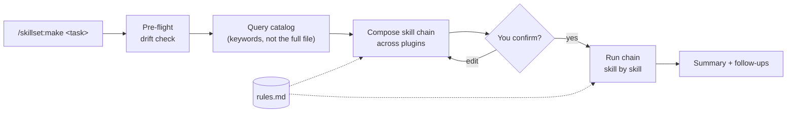
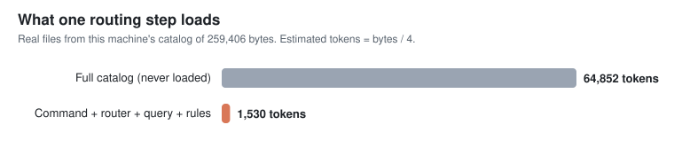
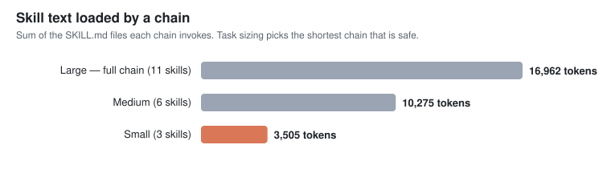
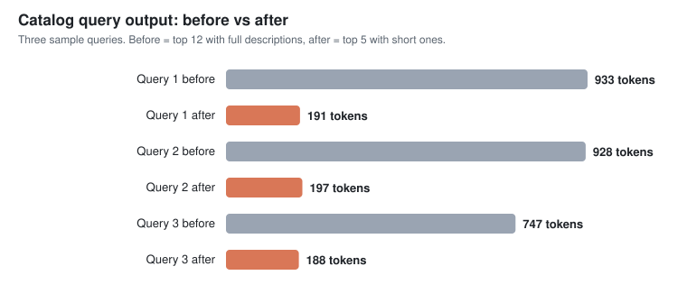

<div align="center">

# skillset

**One entry point for every skill in every Claude Code plugin you have installed.**

Describe what you want to do. skillset picks the right chain of skills across your plugins, shows you the plan, and runs it once you approve.


</div>

---

## Why

Install a handful of Claude Code plugins and you quickly end up with hundreds of skills. Some overlap, some are easy to forget, and nobody remembers the right order to call them in.

skillset fixes that:

- **You state the intent**, such as `make`, `plan`, `review` or `development`. You don't pick skills by hand.
- **It builds a chain** from the skills you actually have installed (superpowers, mattpocock-skills, ecc, vercel, and so on) and explains why each step is there.
- **Nothing runs until you confirm.** You can edit the chain first.
- **It keeps itself fresh.** The catalog is generated from your installed plugins and drift is detected automatically.

## Quick start

```bash
claude plugin marketplace add Wellsonr/skillset
claude plugin install skillset@skillset
```

Restart your Claude Code session, then bootstrap once:

```
/skillset:init
```

`init` writes a manifest of your user-scope plugins, installs anything missing, updates everything to the latest version, builds the skill catalog, and creates a starter rules file.

Now try it:

```
/skillset:make add a date filter to the dashboard
```

## How it works



1. **Pre-flight.** A read-only check compares the catalog with what is installed. If plugins were added, removed or updated, skillset offers `/skillset:update`.
2. **Selective load.** The router queries the catalog by keyword (top 5, short descriptions). It never loads the full catalog into context, which keeps token cost low.
3. **Propose.** You get a table of skill, role and reason, plus the rules that apply. If a skill is missing it substitutes an equivalent, for example `superpowers:test-driven-development` for `mattpocock-skills:tdd`.
4. **Confirm, then execute.** The chain runs through each skill's own gates, and approval steps are never bypassed.

Trivial questions skip all of this and get a direct answer.

## Commands

| Command | What it does |
|---|---|
| `/skillset:init` | One-time bootstrap: manifest, install missing plugins, update all, generate catalog and starter rules |
| `/skillset:update` | Update every plugin in the manifest to the latest version and regenerate the catalog |
| `/skillset:doctor` | Read-only audit of catalog, drift, manifest, rules and duplicate skills |
| `/skillset:make <task>` | Idea to working code |
| `/skillset:development <task>` | Full lifecycle: design, plan, TDD, review, PR, deploy |
| `/skillset:plan <task>` | Produce an implementation plan |
| `/skillset:execute <plan>` | Execute an existing plan |
| `/skillset:review` | Review the changes from the current session |
| `/skillset:rules` | View and edit your custom rules |
| `/skillset:catalog` | Browse the skill catalog |

### Example chain

For `/skillset:development`, the starting chain looks like this and is then adapted to your task:

```
brainstorming → codebase-design / domain-modeling → writing-plans
  → test-driven-development → code-review → verification-before-completion
  → requesting / receiving code review → finishing-a-development-branch
  → commit-push-pr → deploy (Vercel, Cloudflare, PM2 or Docker, detected from your stack)
```

## Custom rules

Rules live in `~/.claude/skillset/data/rules.md` and apply **only inside skillset workflows**, never in your regular Claude Code sessions.

```markdown
## web-project
<!-- trigger: task builds a new web frontend -->
- Ship a service worker (PWA-ready)
```

The starter file created by `/skillset:init` includes an always-on section that applies to every workflow. Any other section activates only when its trigger matches your task. View and edit all of them with `/skillset:rules`.

## Why it works

The idea is simple: **never put the whole catalog in context, and never run a longer chain than the task needs.** These charts come from real files on a machine with 25 plugins and 470 skills, and you can regenerate them with `node scripts/bench.mjs`.



A routing step reads about 1,500 tokens (the command, the router, a 5-row query and your rules) instead of the 65,000-token catalog, so the catalog can keep growing without slowing routing down.



Most of the cost is the skills a chain loads. A small task runs 3 skills (about 3,500 tokens) instead of the full 11 (about 17,000), which is **79% less**. A medium task is **39% less**.



Catalog queries now return 5 short rows instead of 12 long ones, **75–79% less** on the three sample queries.

**Method and limits.** Tokens are estimated as bytes / 4, so read the ratios, not the absolute numbers. The charts measure skill text loaded, not total session cost, and they do not include the savings from running mechanical phases on cheaper models, which depend on your workload and which I have not measured. Cheaper chains are only safe when the task really is small, so the router shows the detected size in every proposal and you can force the full chain with `--full`.

## Saving tokens

skillset is built to be cheap to run. Routing itself costs roughly 1,500 tokens, and the full catalog is never loaded. Most of the real cost is the skills a chain loads and the model that runs them, so the router trims both:

- **Task sizing.** `make` and `development` size the task first. A small change runs just TDD, verification and commit (about 3,500 tokens of skill text) instead of the full 11-skill lifecycle (about 17,000), roughly 79% less. Tasks touching auth, payments, DB migrations or secrets are never sized below medium. Add `--full` to the task to force the whole chain.
- **Cheaper models for mechanical phases.** Verification, commits and finishing a branch run in Haiku subagents, and implementation and reviews in Sonnet subagents. Skills that need your input always stay in your session model. Override any phase in the `## models` section of `~/.claude/skillset/data/rules.md` (`haiku`, `sonnet`, `opus` or `main`).
- **Lean catalog queries.** `query` returns the top 5 matches with short descriptions, about 75–80% less output. Use `--full` for the old behavior.
- **Fewer plugins, smaller prompt.** Every installed plugin lists its skills in each session's system prompt. Disable plugins you no longer use to cut that fixed cost.

The proposal always shows the detected size, the model per phase, and which steps were trimmed, and nothing runs until you confirm.

## Stays out of your way

- **Read-only hook.** A `SessionStart` hook checks for drift and prints at most one line. It never changes anything and always exits 0, so it cannot break your session.
- **`doctor` only reports.** It exits 0 when everything is fine, 1 on warnings or failures, and 2 on invalid data files.
- **Your data stays local.** State lives in `~/.claude/skillset/data/` (`manifest.json`, `rules.md`, `catalog.json`, `catalog.md`), outside the plugin and safe from updates.
- **Zero dependencies.** The scripts are plain Node ESM using only the standard library.

## FAQ

**Does it replace my other plugins?**
No. It routes to them. If a plugin isn't installed, skillset skips or substitutes that step and tells you.

**Can it run something without asking me?**
No. Every chain is proposed and needs your explicit approval first.

**Will it slow down my sessions?**
The session hook is a single local file check. Routing loads only the catalog entries that match your task.

**How do I add a plugin to the set it manages?**
Edit `~/.claude/skillset/data/manifest.json`, then run `/skillset:update`.

## Development

```bash
node --test tests/*.test.mjs   # 55 unit tests, no install step needed
claude plugin validate .       # run from the repo root
node scripts/bench.mjs         # regenerate the charts in docs/assets from your own catalog
```

`bench.mjs` needs `/skillset:init` to have run, and the `superpowers`, `mattpocock-skills` and `commit-commands` plugins installed, because the chains it measures use their skills.

Layout:

```
commands/     slash commands (init, update, make, development, ...)
skills/       router procedure shared by all routing commands
scripts/      scan, sync, query, doctor, shared lib (Node ESM)
hooks/        read-only SessionStart drift check
templates/    starter rules file
tests/        node:test suites and fixtures
docs/         design spec, plans, manual verification checklist
```

## Contributing

Issues and pull requests are welcome. Please run the test suite and `claude plugin validate .` before opening a PR. Bump `version` in both `.claude-plugin/plugin.json` and `.claude-plugin/marketplace.json` for any change users should receive, because `claude plugin update` detects releases by version.

## License

[MIT](LICENSE) © Wellsonr
